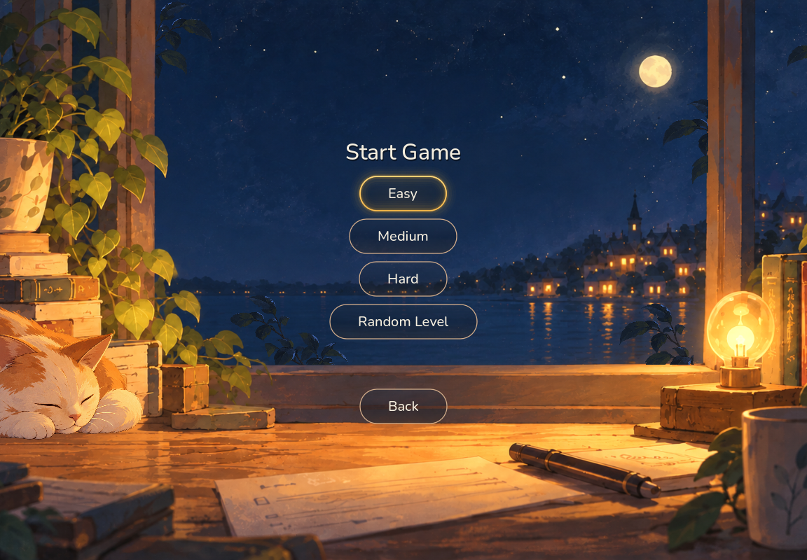
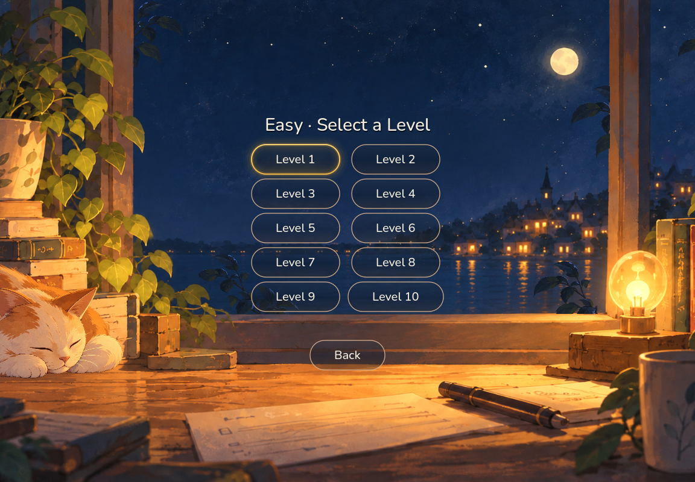
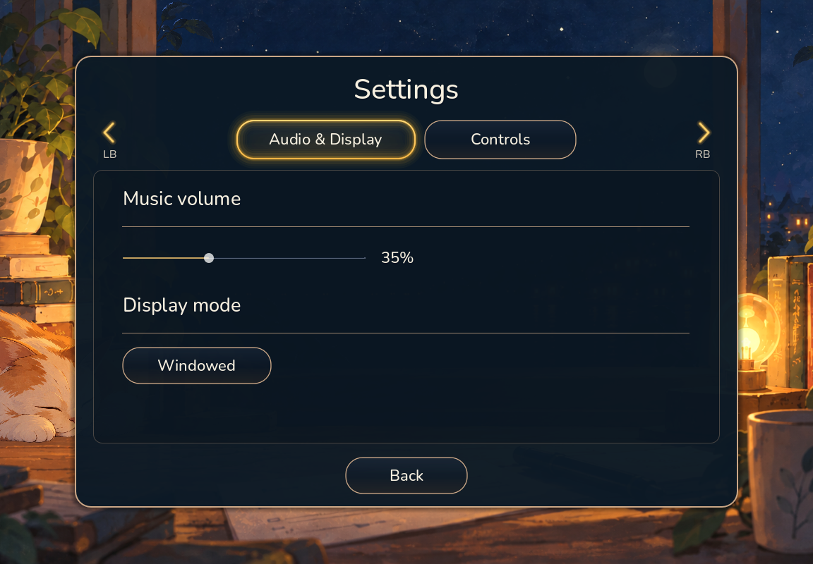

# Project Lumen

Project Lumen is a 2D Akari (Light Up) puzzle game built with Godot 4.7.2. The prototype separates puzzle rules from presentation and uses seeded procedural generation to create boards with at least one valid solution.

## Current status

The project contains three difficulty presets, each with ten reproducible levels, plus a random mode that chooses uniformly among registered difficulties. The game includes a first-launch tutorial, Settings, music and global mute controls, windowed/fullscreen support, mouse/keyboard/gamepad interaction, puzzle feedback, level progression, and a victory screen.

The selected visual direction is Quiet Ink, with a warm illustrated room, hand-lettered title, translucent controls with amber lighting, and a short sparkle celebration on victory. The background, title, and board animations were approved on 2026-10-25. The latest [visual review](docs/VISUAL_REVIEW.md) covers every screen and records remaining findings; the external playtest remains a later task. See [`TASKS.md`](TASKS.md) for current status and remaining work.

## Screenshots

| Main menu | Difficulty selection |
|:--:|:--:|
|  |  |
| Level selection | Gameplay in progress |
|  |  |
| Settings — Audio & Display | Settings — Controls |
|  |  |
| Tutorial | Victory |
|  |  |

These real Godot captures were refreshed on 2026-10-25 at 1152 × 800. The [visual review and full capture catalog](docs/VISUAL_REVIEW.md) include 40 images across 1152 × 800, 1920 × 1080, and 1152 × 640, covering all tutorial steps, difficulty presets, board feedback, random mode, victory variants, and the load-error fallback. Captures use an isolated process and temporary preferences without interrupting an open play session. See the [capture tool instructions](tools/README.md) to reproduce them, and the [UI style guide](docs/UI_STYLE_GUIDE.md) for scaling behavior.

## Run the project

Open `project.godot` in Godot 4.7.2 and press F5. The configured main scene is `src/presentation/main.tscn`. See [`docs/DEVELOPMENT_SETUP.md`](docs/DEVELOPMENT_SETUP.md) for setup and the development-tool connection.

## Play

Left-click a playable cell to place or remove a bulb. Right-click toggles an X note; marking a bulb replaces it with X. The goal is to illuminate every playable cell, avoid bulb conflicts, and satisfy every numbered wall. The tutorial explains the rules in game.

- **Keyboard:** arrows or WASD navigate; Space toggles a bulb; X toggles a note; Enter/Space activates a focused button; Escape returns to the main menu from gameplay or victory.
- **Gamepad:** D-pad or left stick navigates; A toggles a bulb or confirms; X toggles a note; B backs out of a submenu or exits gameplay to the main menu.
- **Mouse:** pointer movement or a click shows the pointer again. It hides after three seconds of inactivity or when another input method is used.

Restart clears player moves and keeps the current board. Exit to Menu discards the active session. Music volume, global mute, display mode, and the tutorial-seen state are saved locally. Puzzle progress and random seeds are not saved. See [`docs/INPUT_CONTROLS.md`](docs/INPUT_CONTROLS.md) for the full control and navigation reference.

## Project guide

- [`AGENTS.md`](AGENTS.md) — working conventions and repository index.
- [`TASKS.md`](TASKS.md) — completed work and the external-playtest task.
- [`docs/PROJECT_OVERVIEW.md`](docs/PROJECT_OVERVIEW.md) and [`docs/PROTOTYPE_DEFINITION.md`](docs/PROTOTYPE_DEFINITION.md) — project scope and agreed prototype behavior.
- [`docs/ARCHITECTURE.md`](docs/ARCHITECTURE.md) — code responsibilities and data flow.
- [`docs/REFINEMENT_PLAN.md`](docs/REFINEMENT_PLAN.md) — implementation status, work packages, review checkpoints, and later playtest milestone.
- [`docs/PROCEDURAL_GENERATION.md`](docs/PROCEDURAL_GENERATION.md) — difficulty presets, seeds, validity, and reproducibility.
- [`docs/UI_STYLE_GUIDE.md`](docs/UI_STYLE_GUIDE.md) and [`docs/UI_ASSET_BRIEF.md`](docs/UI_ASSET_BRIEF.md) — current Quiet Ink implementation and its visual-production decisions.
- [`docs/ANIMATION_IMPLEMENTATION.md`](docs/ANIMATION_IMPLEMENTATION.md) — integrated motion layers, timing, and Inspector tuning.
- [`docs/VISUAL_REVIEW.md`](docs/VISUAL_REVIEW.md) — latest screen review, evidence, findings, and complete screenshot catalog.
- [`assets/ASSET_MANIFEST.md`](assets/ASSET_MANIFEST.md) — asset sources and licenses.
- [`tests/README.md`](tests/README.md) — automated verification and manual-review coverage.
